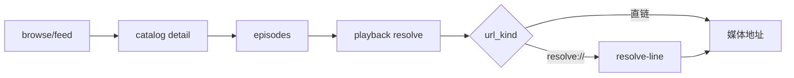

# 影视源（看剧AI · 懂片帝）

面向 [kanju.ai](https://kanju.ai) 与 [dongpian6.com](https://dongpian6.com) 的视频源，提供 **Python / JS（QuickJS）/ Java** 三种实现，功能对齐：
分类、筛选、搜索、详情、剧集、多线路播放。

- 站点：

| 站点 | 域名 | 实现 |
|---|---|---|
| 看剧AI | `https://kanju.ai`（同源 `kanju3.com`） | Python / JS / Java |
| 懂片帝 | `https://dongpian6.com` | JS（`js/dongpian6.js`） |

- 配置路径：全部使用相对路径，便于自建镜像
- 内容说明：仓库只含客户端代码与配置，不存储、不转码、不分发媒体文件

> 两个站同一套 API 家族（同源 `/v1/*` + 客户端 HMAC 签名），差异见[两站差异](#两站差异)。

---

## 目录

- [特性](#特性)
- [目录结构](#目录结构)
- [快速开始](#快速开始)
- [两站差异](#两站差异)
- [配置字段](#配置字段)
- [接口说明](#接口说明)
- [签名机制](#签名机制)
- [验证记录](#验证记录)
- [常见问题](#常见问题)
- [维护与更新](#维护与更新)
- [免责](#免责)

---

## 特性

| 能力 | 说明 |
|---|---|
| 分类 | 全部 / 电影 / 剧集 / 短剧 / 动漫 / 综艺 / 纪录片 / 体育 |
| 筛选 | 年份、地区 |
| 搜索 | 站点 `q=` 检索，单页 20 条 |
| 详情 | 片名、封面、年份、地区、类型、导演、演员、简介、集数 |
| 播放 | 直链优先 → `resolve://` 二次解析 → 最多 5 条线路回退 |
| 稳健性 | 签名密钥运行时提取；401 自动建匿名会话重试一次 |
| 首页 | 站点 `/v1/feed/home` 多分区推荐，失败回退分类首页 |

---

## 目录结构

```
source/
├─ README.md
├─ python/                     FongMi 内核 + Chaquopy（影视TV / OKTV）
│  ├─ kanju.py                 源本体（type 3）
│  └─ kanju.json               配置（api: ./kanju.py）
├─ js/                         FongMi QuickJS（影视TV / OKTV，无需 Python）
│  ├─ kanju.js                 看剧AI 源（双桥接 + 纯 JS HMAC）
│  ├─ kanju.json               配置（api: ./kanju.js）
│  ├─ dongpian6.js             懂片帝 源（双桥接 + 运行时取密钥 + 可达性校验）
│  └─ dongpian6.json           配置（api: ./dongpian6.js）
└─ java/                       TVBox / CatVodSpider / FongMi（dex jar）
   ├─ spider.jar               含 csp_Kanju + Proxy
   ├─ spider.jar.md5           与 jar 对齐
   ├─ kanju_jar.json           配置（spider: ./spider.jar）
   ├─ src/Kanju.java           源码
   ├─ src/Proxy.java           加载器兼容壳
   └─ BUILD.md                 编译 / d8 / 打包步骤
```

---

## 快速开始

配置地址（任选其一，可换成自建镜像）：

| 版本 | 地址 |
|---|---|
| Python（看剧AI） | `https://raw.githubusercontent.com/z2004y/source/main/python/kanju.json` |
| JS（看剧AI） | `https://raw.githubusercontent.com/z2004y/source/main/js/kanju.json` |
| JS（懂片帝） | `https://raw.githubusercontent.com/z2004y/source/main/js/dongpian6.json` |
| Java（看剧AI） | `https://raw.githubusercontent.com/z2004y/source/main/java/kanju_jar.json` |

### Python

1. `设置 → 点播 → 粘贴地址 → 确定`
2. 回首页选「看剧AI」
3. 可选 `ext` 见[配置字段](#配置字段)

需要客户端带 **Chaquopy**。

### JS（QuickJS）

同上步骤，站点名「看剧AI(JS)」/「懂片帝(JS)」。源码做过桥接适配：

- 官方桥接：`net.http(url, opts)`；
- 部分分支（OKTV）：全局 `http(url, opts)`，且方法**必须返回 JSON 字符串**；
- 启动时自动探测，两种都能跑；
- 不使用并发 HTTP（该桥接会互相取消），详情/剧集串行请求；
- 两个源都默认返回 JSON 字符串（只吃对象的分支给 `ext.json=false`）。

### Java

- `spider` 为相对路径 `./spider.jar`，与配置同目录解析；
- 入口类 `com.github.catvod.spider.Kanju`，`api` 为 `csp_Kanju`；
- 自行构建见 [`java/BUILD.md`](java/BUILD.md)。

### 自建镜像 / 局域网

配置里 `./kanju.py`、`./kanju.js`、`./spider.jar` 都按**配置文件所在目录**解析，镜像只需整目录拷贝：

```bash
cd js             # 或 python / java
python -m http.server 8000
# App 配置地址： http://<电脑IP>:8000/kanju.json
```

---

## 两站差异

同属一个 API 家族（`/v1/*` + HMAC 签名），以下是实测到的不一样的地方：

| 维度 | 看剧AI | 懂片帝 |
|---|---|---|
| 签名密钥位置 | `assets/movie-card-runtime-*.js` | 同上（运行时正则提取，不落常量） |
| `x-ai-movie-client-*` 头 | 服务端校验 | **实测不校验**（只验签名，不实现） |
| 匿名会话 | 401 时建会话重试一次 | **实测不需要**（无 Cookie 逻辑） |
| 剧集翻页 | `/episodes?limit=48&offset=` | 单次硬顶 **120**，用 `/episodes?limit=120&offset=` 补齐（实测 348 集可达） |
| 线路 UI | 多线路（`$$$`） | **单线路**，集内自动选线（直链 m3u8 → mp4 → `resolve://`） |
| 线路可用性 | 失败回退 5 条 | 回退前先探可达性（最多 4 条），全不可达才降级 `parse:1` |
| 片头/片尾跳过 | — | 用站点 `playback_skip_settings_preset` + HLS `EXTINF` 总时长 |
| 成功响应 | 不带 `msg` | 不带 `msg`（带了会被当错误并中止播放） |

---

## 配置字段

### Python / JS（`python/kanju.json`、`js/kanju.json`）

| 字段 | 说明 |
|---|---|
| `sites[].key` | `kanju`（JS 为 `kanju_js`）/ `dongpian6_js` |
| `sites[].api` | `./kanju.py` / `./kanju.js` / `./dongpian6.js`（相对配置位置） |
| `sites[].ext.host` | 站点根地址，默认 `https://kanju.ai` / `https://dongpian6.com` |
| `sites[].ext.line` | 强制线路名片段（如 `1080P`），留空=默认 |
| `sites[].searchable` / `quickSearch` | `1` 启用 |
| `dongpian6.ext.verify` | `false` = 关掉播放前可达性探测（省一次请求，但可能拿到失效线路） |
| `dongpian6.ext.skips` / `skipIntro` / `skipOutro` | `false` = 关掉片头/片尾自动跳过（默认开） |
| `dongpian6.ext.json` | 默认 `true`（返回 JSON 字符串）；只吃对象的分支设 `false` |
| `dongpian6.ext.key` | 仅在自动提取签名密钥失效时手工指定（正常不需要） |

### Java（`java/kanju_jar.json`）

| 字段 | 值 |
|---|---|
| `spider` | `./spider.jar` |
| `sites[].api` | `csp_Kanju` |
| `sites[].type` | `3` |

---

## 接口说明

| 用途 | 请求 |
|---|---|
| 分类 / 搜索 | `GET /v1/browse/catalog?page=&limit=&kind=&year=&area=&q=` |
| 首页推荐 | `GET /v1/feed/home?scope=public&mode=preview&sections=3&cards=10` |
| 详情 | `GET /v1/catalog/{id}/detail` |
| 剧集 | `GET /v1/catalog/{id}/episodes?limit=48&offset=0` |
| 线路列表 | `GET /v1/playback/resolve/{episode_token}?view=compact` |
| 最终地址 | `POST /v1/playback/resolve-line` body `{"ticket":"<public_id>"}` |



---

## 签名机制

站点对 `/v1/*` 强制客户端 HMAC 签名：

```
canonical = "{METHOD}\n{path?query}\n{timestamp_ms}\n{nonce_hex32}"
signature = HMAC-SHA256(key, canonical).hex()
```

请求头：`x-ai-movie-timestamp / -nonce / -signature / -client-name / -client-version / -build-version / -protocol-version`。

实现要点：

1. **密钥不硬编码**：启动时抓首页 → 定位 `assets/movie-card-runtime-*.js` → 正则提取 key 与版本号；
2. **会话**：401 `playback_user_session_required` 时 `POST /v1/users/anonymous`，重签重试一次；
3. **错误显形**：异常带「接口 + code + 响应片段」，不返回成功空列表。

---

## 验证记录

环境：雷电 14（Android 14）+ OKTV 5.2.1（FongMi 内核）。

| 版本 | 载入 | 分类 | 详情 | 播放 | 备注 |
|---|---|---|---|---|---|
| Python | ✅ | ✅ 8 分类 | ✅ | ✅ `state=3` 进度前进 | jar 不需要 |
| JS（QuickJS） | ✅ | ✅ 8 分类 | ✅ 7 集 | ✅ `state=3` +6022ms/6s | 双桥接自动适配 |
| Java | ✅ | ✅ 8 分类 | ✅ | ✅ `state=3` +6035ms/6s | dex jar |
| **懂片帝 JS** | ✅ | ✅ 8 分类 | ✅ 8 集 | ✅ `state=3` +8026ms/8s | 单集（电影）同步验过 |

懂片帝 JS 的详细采样（`/media`，判据 `state=3` 且 `position` 前进）：

```
嫁金钗 第1集  duration=2890041  position 5941 → 13967   (+8.0s / 8s 墙钟 ≈ 1x)
嫁金钗 第3集  duration=3218666  position 3652 → 9673    (+6.0s / 6s)
丛林野人 正片  duration=4096083  position 12792
url = http://127.0.0.1:9978/m3u8.m3u8?url=…   ← App 自己的 HLS 代理，header 生效
```

**发布后回测**：配置地址直接填仓库的 raw 链接
（`https://raw.githubusercontent.com/z2004y/source/main/js/dongpian6.json`），
在同一台模拟器上重测：8 分类全出 → 详情 8 集 → 播放 `state=3`，
`position 7482 → 15513`（+8.0s / 8s）。即仓库里的产物本身是可用的，不是“本地能跑、发布后不行”。

---

## 常见问题

| 现象 | 原因 | 处理 |
|---|---|---|
| 站点不出现 | 配置地址打不开 | 手机浏览器直接访问配置地址确认 |
| 分类空 | 客户端缺对应运行时 | Python 版换 JS/Java；或反过来 |
| JS 报 `'net' is not defined` | 该分支用全局 `http` | 用本仓库 `js/kanju.js`（已双桥接） |
| JS 报 `ClassCastException ... to String` | 该分支要求返回 JSON 字符串 | 仓库版本已统一返回字符串 |
| JS 详情空白 | 并发 HTTP 被桥接取消 | 仓库版本已改串行 |
| Java 报 `ClassNotFoundException: ...Proxy` | jar 缺 Proxy | 用仓库 jar |
| Java 报 `Failed to open dex files` | jar 内是 `.class` 不是 `classes.dex` | 用仓库 jar（d8 生成） |
| 选集黑屏 | 线路失效 / 地址过期 | 已做 5 条回退；可用 `ext.line` 指定 |
| 懂片帝：首页空白但站点名正常 | 该分支要求业务方法返回 **JSON 字符串**，返回对象会被桥接吞掉（日志 `TypeAdapter IndexOutOfBounds`） | 仓库版本已统一 `JSON.stringify`；只吃对象的分支给 `ext.json=false` |
| 懂片帝：有线路但不播放，播放器停在 idle | 成功响应里带了 `msg`，被当成错误提示从而中止播放 | 仓库版本成功时不带 `msg`，只在失败时带 |

---

## 维护与更新

| 场景 | 操作 |
|---|---|
| 站点改签名 | 改 `canonical` 与密钥正则（三版同名逻辑） |
| 新增分类 | 改 `KINDS`（三版） |
| 改线路策略 | 改 `ordered/rank`（三版） |
| 更新 Java | `javac → d8 → jar → 更新 spider.jar.md5` |
| 换域名 | 三版默认 host + 配置 `ext.host` |
| 懂片帝改版 | 改 `js/dongpian6.js`：密钥正则 `ensureConf()`、canonical `signHeaders()`、剧集上限 `EP_PAGE` |
| 懂片帝换域名 | 改 `js/dongpian6.json` 的 `ext.host`（无需改代码） |

---

## 免责

代码仅用于个人学习与自建源调试。内容版权归原站点与权利人所有，本仓库不存储、不转码、不分发任何媒体文件。
