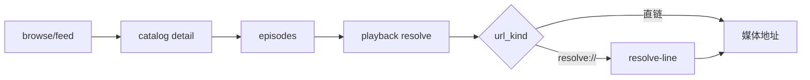

# 看剧AI 视频源

面向 [kanju.ai](https://kanju.ai) 的视频源，提供 **Python** 与 **Java** 两种实现，功能对齐：
分类、筛选、搜索、详情、剧集、多线路播放。

- 站点域名：`https://kanju.ai`（同源 `kanju3.com`）
- 配置路径：全部使用相对路径，便于自建镜像
- 内容说明：仓库只含客户端代码与配置，不存储、不转码、不分发媒体文件

---

## 目录

- [特性](#特性)
- [目录结构](#目录结构)
- [快速开始](#快速开始)
- [配置字段](#配置字段)
- [接口说明](#接口说明)
- [签名机制](#签名机制)
- [验证记录](#验证记录)
- [常见问题](#常见问题)
- [维护与更新](#维护与更新)
- [免责](#免责)

---

## 特性

| 能力 | 说明 |
|---|---|
| 分类 | 全部 / 电影 / 剧集 / 短剧 / 动漫 / 综艺 / 纪录片 / 体育 |
| 筛选 | 年份、地区 |
| 搜索 | 站点 `q=` 检索，单页 20 条 |
| 详情 | 片名、封面、年份、地区、类型、导演、演员、简介、集数 |
| 播放 | 直链优先 → `resolve://` 二次解析 → 最多 5 条线路回退 |
| 稳健性 | 签名密钥运行时提取；401 自动建匿名会话重试一次 |
| 首页 | 站点 `/v1/feed/home` 多分区推荐，失败回退分类首页 |

---

## 目录结构

```
source/
├─ README.md
├─ python/                     FongMi 内核 + Chaquopy（影视TV / OKTV）
│  ├─ kanju.py                 源本体（type 3）
│  └─ kanju.json               配置（api: ./kanju.py）
└─ java/                       TVBox / CatVodSpider / FongMi（dex jar）
   ├─ spider.jar               含 csp_Kanju + Proxy
   ├─ spider.jar.md5           与 jar 对齐
   ├─ kanju_jar.json           配置（spider: ./spider.jar）
   ├─ src/Kanju.java           源码
   ├─ src/Proxy.java           加载器兼容壳
   └─ BUILD.md                 编译 / d8 / 打包步骤
```

---

## 快速开始

### 前置

| 客户端 | 说明 |
|---|---|
| 影视TV / FongMi TV / OKTV | 支持 Python 源（内置 Chaquopy），也可加载 Java jar |
| TVBox / CatVodSpider | 走 Java 版，无需 Python |

### Python 版

配置地址（任选其一，路径可换成自建镜像）：

```
https://raw.githubusercontent.com/z2004y/source/main/python/kanju.json
https://cdn.jsdelivr.net/gh/z2004y/source@main/python/kanju.json
```

1. 打开 `设置 → 点播 → 粘贴地址 → 确定`
2. 回首页选择站点「看剧AI」
3. 可选 `ext` 见[配置字段](#配置字段)

### Java 版

```
https://raw.githubusercontent.com/z2004y/source/main/java/kanju_jar.json
https://cdn.jsdelivr.net/gh/z2004y/source@main/java/kanju_jar.json
```

- `spider` 为相对路径 `./spider.jar`，与配置同目录解析；
- 入口类 `com.github.catvod.spider.Kanju`，`api` 为 `csp_Kanju`；
- 自行构建见 [`java/BUILD.md`](java/BUILD.md)。

### 自建镜像 / 局域网

配置里 `./kanju.py`、`./spider.jar` 都按**配置文件所在目录**解析，所以镜像只需整目录拷贝：

```bash
cd java           # 或 cd python
python -m http.server 8000
# App 配置地址： http://<电脑IP>:8000/kanju_jar.json
```

换自有域名时：把目录放上去，替换 App 里的配置地址即可，**文件内容无需修改**。

---

## 配置字段

### Python（`python/kanju.json`）

| 字段 | 类型 | 说明 |
|---|---|---|
| `sites[].key` | string | 站点唯一 ID，`kanju` |
| `sites[].api` | string | `./kanju.py`（相对配置位置） |
| `sites[].ext.host` | string | 站点根地址，默认 `https://kanju.ai` |
| `sites[].ext.line` | string | 强制线路名片段（如 `1080P`），留空=默认 |
| `sites[].searchable` | int | `1` 启用搜索 |
| `sites[].quickSearch` | int | `1` 启用快速搜索 |

### Java（`java/kanju_jar.json`）

| 字段 | 值 |
|---|---|
| `spider` | `./spider.jar` |
| `sites[].key` | `kanju` |
| `sites[].api` | `csp_Kanju` |
| `sites[].type` | `3` |

---

## 接口说明

| 用途 | 请求 |
|---|---|
| 分类 / 搜索 | `GET /v1/browse/catalog?page=&limit=&kind=&year=&area=&q=` |
| 首页推荐 | `GET /v1/feed/home?scope=public&mode=preview&sections=3&cards=10` |
| 详情 | `GET /v1/catalog/{id}/detail` |
| 剧集 | `GET /v1/catalog/{id}/episodes?limit=48&offset=0` |
| 线路列表 | `GET /v1/playback/resolve/{episode_token}?view=compact` |
| 最终地址 | `POST /v1/playback/resolve-line` body `{"ticket":"<public_id>"}` |



---

## 签名机制

站点对 `/v1/*` 强制客户端 HMAC 签名：

```
canonical = "{METHOD}\n{path?query}\n{timestamp_ms}\n{nonce_hex32}"
signature = HMAC-SHA256(key, canonical).hex()
```

请求头：

```
x-ai-movie-timestamp  x-ai-movie-nonce  x-ai-movie-signature
x-ai-movie-client-name  x-ai-movie-client-version
x-ai-movie-build-version  x-ai-movie-protocol-version
```

实现要点：

1. **密钥不硬编码**：启动时抓首页 → 定位 `assets/movie-card-runtime-*.js` → 正则提取 key 与版本号，进程内/TTL 缓存；
2. **会话**：部分片源返回 401 `playback_user_session_required`，自动 `POST /v1/users/anonymous` 后重签重试一次；
3. **错误显形**：异常信息带「接口 + 服务端 code + 响应片段」，不返回「成功空列表」。

---

## 验证记录

环境：雷电 14（Android 14）+ OKTV 5.2.1（FongMi 内核）。

| 版本 | 载入 | 分类 | 详情 | 播放 | 备注 |
|---|---|---|---|---|---|
| Python | ✅ | ✅ 8 分类 | ✅ | ✅ `state=3` 进度前进 | 真机实测 |
| Java | ✅ | ✅ 8 分类 | ✅ | ✅ `state=3` +6s/6s | 真机实测 |

接口侧：

| 检查 | 结果 |
|---|---|
| 配置 / jar 可达 | 200 |
| `spider.jar.md5` 与 jar | 一致 |
| 签名实现 | 与 Node crypto 对照一致 |
| 首页 feed | 多分区合并正常 |

---

## 常见问题

| 现象 | 原因 | 处理 |
|---|---|---|
| 站点不出现 | 配置地址打不开 | 手机浏览器直接访问配置地址确认 |
| 站点出现、分类空 | 客户端缺 Python 运行时 | 改用 Java 版 |
| 主页「推荐」空 | 首页接口失败 | 已改用 feed 并回退分类页；清 App 缓存后重进 |
| Java 报 `ClassNotFoundException: ...Proxy` | jar 缺 `Proxy` | 用仓库 jar 或按 BUILD.md 打包 |
| Java 报 `Failed to open dex files` | jar 内是 `.class` 而非 `classes.dex` | 用仓库 jar（d8 生成） |
| 选集黑屏 | 线路失效 / 地址过期 | 源已回退 5 条线路；可用 `ext.line` 指定 |
| 改了 jar 但没生效 | App / CDN 缓存 | 清 App 缓存；CDN 等 1–3 分钟 |

---

## 维护与更新

| 场景 | 操作 |
|---|---|
| 站点改签名 | 改 `canonical` 与密钥正则（`_api()` / `signedRequest()`） |
| 新增分类 | 改 `KINDS` 常量（两版） |
| 改线路策略 | 改 `_ordered_lines()` / `rank()` |
| 更新 Java | `javac → d8 → jar → 更新 spider.jar.md5` |
| 换域名 | 改两版默认 host + Python 配置 `ext.host` |

本地自测（不装 App）：

```bash
cd python && python -m http.server 8000
# 浏览器打开 http://127.0.0.1:8000/kanju.json 应返回配置 JSON
# 再在 App 里用局域网地址加载，验证 首页 → 分类 → 详情 → 播放
```

---

## 免责

代码仅用于个人学习与自建源调试。内容版权归原站点与权利人所有，本仓库不存储、不转码、不分发任何媒体文件。
